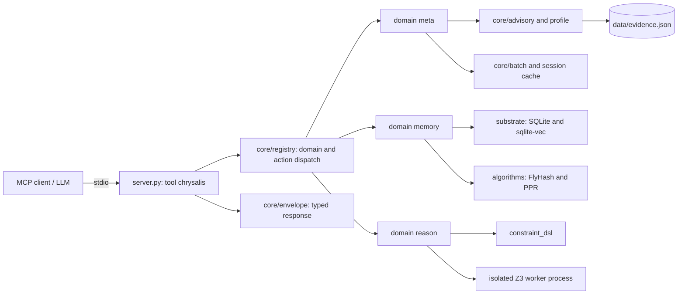
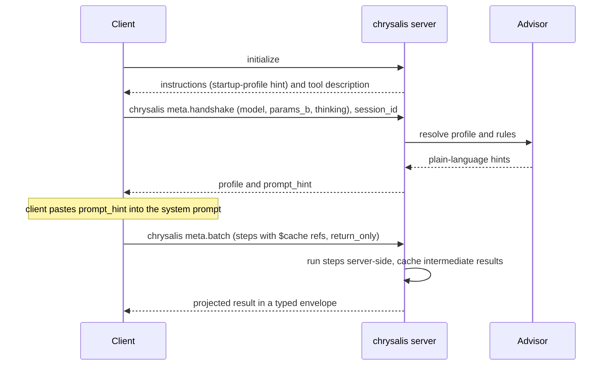
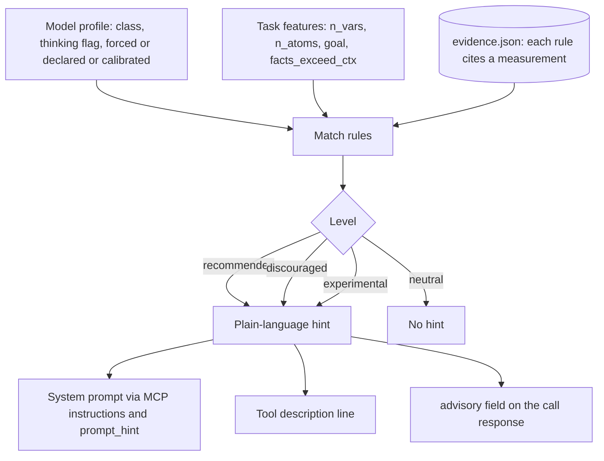

<a id="readme-top"></a>

<div align="center">

# chrysalis-bridge

**One MCP tool that gives a frozen, small, local LLM graph memory, continual learning outside the weights, SMT reasoning, and evidence-based advice on when to use them.**

[](https://www.python.org/)
[](https://modelcontextprotocol.io)
[](https://github.com/Z3Prover/z3)
[](https://github.com/asg017/sqlite-vec)
[](https://numpy.org/)
[](https://github.com/ggml-org/llama.cpp)
[](https://ai.google.dev/gemma)
[](tests/)
[](https://docs.astral.sh/ruff/)
[](https://docs.astral.sh/uv/)
[](LICENSE)

</div>

> [!NOTE]
> This is a research prototype with preliminary evidence. Every number below comes from small
> experiments on a single model; see [Limitations](#limitations) before drawing conclusions.

## Table of contents

1. [What it is and why](#what-it-is-and-why)
2. [Key ideas](#key-ideas)
3. [Architecture](#architecture)
4. [The single tool contract](#the-single-tool-contract)
5. [Quickstart](#quickstart)
6. [Validation and results](#validation-and-results)
7. [Limitations](#limitations)
8. [Related work and what is different](#related-work-and-what-is-different)
9. [Roadmap](#roadmap)
10. [Project layout](#project-layout)
11. [Contributing](#contributing)
12. [License](#license)
13. [Acknowledgements](#acknowledgements)

<p align="right"><a href="#readme-top">back to top</a></p>

## What it is and why

Small local models (here Gemma 4 E4B served by llama.cpp) are cheap, private and fast, but they
forget everything between sessions, have a short window, and are unreliable at multi-constraint
logic. Retraining or fine-tuning them for each of those gaps is expensive and, for a user running
on a laptop or an iGPU, usually out of reach.

`chrysalis-bridge` augments a **frozen** model from the outside, over MCP, without retraining:

- **Memory** that survives sessions and scales beyond the context window.
- **Learning** that happens in an external store, not in the weights.
- **Reasoning** delegated to an exact solver (Z3) for problems the model gets wrong.
- **Advice** about when each capability helps or hurts that particular model on that particular
  task, derived from measured results and not from intuition.

The package is called `chrysalis-mcp`; the repository is `chrysalis-bridge`.

<p align="right"><a href="#readme-top">back to top</a></p>

## Key ideas

| Idea | What it means here |
|------|--------------------|
| **Graph memory (HippoRAG-style PPR)** | Knowledge goes in as triples. Recall seeds a Personalized PageRank walk over the graph, so multi-hop questions reach facts that a nearest-neighbour lookup misses. Dense vectors live in sqlite-vec. |
| **Fly-inspired continual learning outside the weights** | A FlyHash sparse code (random expansion plus winner-take-all) indexes nodes; `memory.update` strengthens associations Hebbian-style in the store. Old associations are not overwritten by new ones. FlyHash retrieval itself is experimental, see the results. |
| **Z3 reasoning via a JSON DSL** | `reason.solve` and `reason.check` take either SMT-LIB 2 or a safe JSON constraint DSL (never `eval`), run in an isolated worker process with a timeout. |
| **Model-aware, task-conditioned, evidence-based advisories** | The server holds `evidence.json`: rules that cite a measurement, keyed by model class, thinking mode and task features. It turns them into a plain-language hint and delivers it through the system prompt and the tool description. |
| **Anti-chatty single-tool design** | One tool, `chrysalis(domain, action, ...)`, with self-discovery, server-side batching and graded verbosity, so the model spends its few tokens on the task instead of on a large tool list. |

<p align="right"><a href="#readme-top">back to top</a></p>

## Architecture

### Components



### Session flow



### Advisory decision



<p align="right"><a href="#readme-top">back to top</a></p>

## The single tool contract

The server exposes exactly one MCP tool:

```
chrysalis(domain, action, params={}, verbosity="summary",
          session_id=None, store_as=None, telemetry=None, agent_id=None)
```

Call `meta.schema` for the full machine-readable contract, or `meta.discover` for a compact map.

| Domain | Action | Purpose |
|--------|--------|---------|
| `meta` | `schema` | Full contract: every domain, action, params and an example. |
| `meta` | `discover` | Compact orientation, optionally for one `domain`. |
| `meta` | `handshake` | Declare the calling model (`model`, `family`, `params_b`, `active_params_b`, `context`, `thinking`, `client`); returns `prompt_hint`. |
| `meta` | `calibrate` | Session-specific probes checked by the server; measured profile overrides a declared one. |
| `meta` | `advise` | Advisory level of a `domain`/`action` for a given `task` and the session model. |
| `meta` | `stats` | Calls, errors, bytes, `est_tokens` and time, grouped by action or `agent_id`. |
| `meta` | `batch` | Chain up to 25 steps server-side. |
| `memory` | `ingest` | Add knowledge triples (nodes, edges, FlyHash code, dense vector). |
| `memory` | `recall` | Associative recall: `mode` `ppr` (default) or `seeds`. `ppr` includes the learned boost (`lambda`, on a [0,1] scale via `BOOST_SCALE`); for learned nodes it also returns `learned_as` facts and a `learned` flag. |
| `memory` | `update` | Reinforce the association between a query and a node; stores up to 3 teach examples per node. |
| `memory` | `forget` | Soft-invalidate the edges of a `source`. |
| `memory` | `consolidate` | Decay learned associations and prune weak ones; drops orphan examples. |
| `memory` | `restore` | List or restore verified rotating backups taken before `forget`/`consolidate`. |
| `reason` | `solve` | Solve an SMT-LIB 2 problem (`smt2`) or a JSON constraint problem (`constraints`) with Z3. |
| `reason` | `check` | Check whether an `assignment` satisfies the problem. |

**Envelope.** Every response is one typed object with `status`, `severity` (INFO, WARN, ERROR),
`summary`, `next_action`, `truncated`, `cursor`, and a telemetry block (`request_id`, `ms`, `bytes`,
`est_tokens`). Oversized payloads are clamped; the telemetry block is omitted in `brief` and `terse`
unless requested.

**Verbosity.** `detail`, `summary` (default), `brief`, `terse`. Lower levels cap list and string
sizes; error text and advisory hints are never truncated.

**Batch with `$ref` and `return_only`.** Intermediate results stay on the server:

```json
{
  "domain": "meta", "action": "batch", "session_id": "run-1",
  "params": {
    "steps": [
      {"id": "a", "domain": "memory", "action": "recall",
       "params": {"query": "who owns the lab?", "k": 3}, "store_as": "hits"},
      {"id": "b", "domain": "meta", "action": "stats", "params": {"scope": "all"}}
    ],
    "return_only": "last",
    "select_fields": ["status"]
  }
}
```

A step can reference an earlier result as `$cache.<key>.<field>` (the key is a step `id` or its
`store_as`). `return_only` is `all`, `last` or `summary`; `select_fields` projects dot-paths. A batch
stops at the first error unless `continue_on_error` is set, and nested batches are rejected.

**`session_id`.** Scopes the in-process result cache (`store_as`, `$cache`), the model profile set by
`handshake`/`calibrate`, and per-session stats. State is in memory and per process.

<p align="right"><a href="#readme-top">back to top</a></p>

## Quickstart

Requires Python 3.14 and [uv](https://docs.astral.sh/uv/).

```bash
git clone <this repository>
cd chrysalis-bridge
uv sync
uv run chrysalis-mcp          # stdio MCP server
```

MCP client configuration (stdio):

```json
{
  "mcpServers": {
    "chrysalis": {
      "command": "uv",
      "args": ["run", "--directory", "/path/to/chrysalis-bridge", "chrysalis-mcp"],
      "env": {
        "CHRYSALIS_DB": "/path/to/chrysalis/substrate.db"
      }
    }
  }
}
```

Environment variables:

| Variable | Effect |
|----------|--------|
| `CHRYSALIS_DB` | SQLite path. Default `$XDG_DATA_HOME/chrysalis/substrate.db`, else `~/.local/share/chrysalis/substrate.db`. |
| `CHRYSALIS_MODEL_PROFILE` | Force the model profile for every session (overrides any handshake). |
| `CHRYSALIS_ENFORCE_ADVISORY` | `1` makes a `discouraged` advisory block the call unless `params.override` is `true`. Default: advisory only. |

Example handshake (first call of a session):

```json
{
  "domain": "meta", "action": "handshake", "session_id": "run-1",
  "params": {"model": "gemma-4-e4b", "family": "gemma", "params_b": 4, "thinking": false}
}
```

The response includes a `prompt_hint`: paste it into the system prompt of the model.

Development:

```bash
uv run pytest
uv run ruff check . && uv run ruff format --check .
```

<p align="right"><a href="#readme-top">back to top</a></p>

## Validation and results

Results are generated from `validation/results/*.json` by `python -m validation.report`. They are
reported as measured, including the ones that did not support the hypothesis.

| Hypothesis | Verdict | Result |
|------------|---------|--------|
| H-b: continual learning does not forget (synthetic) | Supported | Accuracy on old associations after 1000 new updates: retention 1.00 with the sparse store vs 0.00 with an overwrite baseline. |
| H-a: two-hop retrieval | Supported | recall@5 0.45 (PPR) vs 0.40 (seeds); one call instead of two. |
| H-b-e2e: learned aliases, model in the loop | Supported | Gemma 4 E4B, 12 learned invented aliases, 300 interference updates. `fly_update` 0.75 vs `no_learn` 0.0 in both thinking modes. The classic alias-ingest baseline scores 0.83 (thinking off) and 1.0 (thinking on). Retrieval recall@5 0.967, retention 1.0 after interference. |
| H-a: end to end | Supported | Accuracy 0.0 alone vs 0.6 with memory. |
| H-a-ctx: memory vs full context | Not supported | 0.6 with memory vs 0.9 with the full context when the facts fit in the window. |
| H-a-scale: facts beyond the window | Supported | 0.35 with memory vs 0.0 with context (+0.35). |
| H-a': FlyHash vs exact cosine | Not supported | At N=1000, FlyHash cluster precision is worse than cosine (about 0.54 x cosine at the shipped setting, best swept 0.69 x). FlyHash retrieval is therefore **experimental**. |
| H-c: solver on small puzzles | Not supported | 0.8 alone vs 0.6 with the solver (thinking off). |
| H-c-hard: solver on hard puzzles | Supported | +0.12 accuracy with the solver in both thinking modes (off 0.18 to 0.29; on 0.82 to 0.94). |
| H-adv held-out, thinking on | Supported | Advised arm 16/16 vs best fixed arm 15/16 (n=16). |
| H-adv held-out, thinking off | Not supported | Advised 0.25 vs best fixed 0.375; the model rarely acts on the hint with thinking off. |
| H-mcp: batching cost | Supported | Estimated tokens: batch 921, sequential 2127, granular tools 7977 (granular is simulated). |

Additional finding: an unconditional "reply with ONLY the JSON object" reminder in the prompt
**suppressed tool calls** (solver use fell to 0 in the ablation), so the project only appends a
format reminder conditionally.

### Fixes found by the evaluation

The validation loop found two real defects in the learning path, both fixed:

- **Boost leak.** The learned boost was unbounded, so unrelated updates destroyed recall (1.0 to 0.06
  after 10 updates). Fixed by normalizing the boost to the KC overlap fraction (`BOOST_SCALE`).
- **Invisible learned associations.** The first LLM run scored fly 0/12 because the model never saw
  why a node was recalled. Fixed with `learned_as` provenance facts; the result became 9/12.

### Limitations

- **Small n.** Held-out sets have 16 items; hard sets 17. Differences of one or two items are within
  noise and no statistical significance is claimed.
- **A single model.** All live results use Gemma 4 E4B. Nothing here shows the effects transfer.
- **Synthetic memory benchmarks.** H-a, H-a', H-b and H-a-scale use generated fictional facts.
- **Thinking off is not supported.** The advisory path works with thinking on and not yet with it off.
- **Tool-call parsing.** Gemma 4 tool calls are sometimes returned as plain content by llama.cpp
  ([issue 22786](https://github.com/ggml-org/llama.cpp/issues/22786)); the harness has to tolerate this.
- **Common-word aliases.** On realistic aliases such as "the big apple", false `learned_as` facts
  appear 17-58% of the time.
- **Interference.** Recall degrades at 300 high-overlap interference updates.
- **Snapshots.** Substrate v4 cannot restore v3 snapshots.
- **Advisories are self-referential.** The evidence rules come from the same benchmarks that report them.

### Reproduce

```bash
uv run pytest                                   # unit and contract tests (no model needed)
uv run pytest -m bench                          # offline benchmarks; write validation/results
python -m validation.eval_llm --hyp hc,hard,adv --thinking both    # needs a live OpenAI-compatible model
python -m validation.report                     # merge results into a verdict table
```

`eval_llm` talks to an OpenAI-compatible endpoint at `CHRYSALIS_LLM_URL`. For local runs,
`validation/llm_server.py --profile e4b` is a resource-guarded launcher for llama.cpp (admission
control, RAM caps, watchdog); read its docstring first, since it manages a GPU-backed process.
Hypothesis groups: `ha`, `ctx`, `hc`, `hard`, `adv`, `cal`, `hascale`, `heldout`, `hbe2e`.

<p align="right"><a href="#readme-top">back to top</a></p>

## Related work and what is different

- **HippoRAG 2** ([arXiv:2502.14802](https://arxiv.org/abs/2502.14802)): graph-based non-parametric
  continual learning with Personalized PageRank. The recall path here follows the same idea at a much
  smaller scale; it is not a reproduction and has not been compared on their benchmarks.
- **FlyHash** (Dasgupta et al., *Science* 2017, [doi:10.1126/science.aam9868](https://doi.org/10.1126/science.aam9868)):
  a fly-olfaction-inspired similarity-search code. In this project's tests it underperforms exact cosine.
- **Larimar** ([arXiv:2403.11901](https://arxiv.org/abs/2403.11901)): episodic memory for LLMs
  with fast updates. Different mechanism: here the memory is an external SQLite graph.
- **Logic-LM** ([arXiv:2305.12295](https://arxiv.org/abs/2305.12295)): LLM plus symbolic solver for
  logical reasoning. `reason` is in the same family, exposed as an MCP action.
- **SMART** ([arXiv:2502.11435](https://arxiv.org/abs/2502.11435)) and
  **When2Tool** ([arXiv:2605.09252](https://arxiv.org/abs/2605.09252)): work on when an agent should
  or should not call a tool. Closest to the advisory idea; they are about the agent's own decision.
- **Dispatch-level instrumentation** ([arXiv:2608.28439](https://arxiv.org/abs/2608.28439)): tool-dispatch
  measurement for agent pipelines; related to the envelope telemetry only loosely.
- **Code Mode** ([Cloudflare](https://blog.cloudflare.com/code-mode/)) and
  **code execution with MCP** ([Anthropic](https://www.anthropic.com/engineering/code-execution-with-mcp)):
  motivation for keeping intermediate results out of the model context. `meta.batch` is a restricted,
  declarative analogue, not general code execution.

**Plausibly novel (not established):** server-side, training-free, model-aware and task-conditioned
tool advisories, learned from evals and delivered through the system prompt. The evidence for this is
preliminary (one model, small n, one positive held-out result with thinking on) and no exhaustive
literature search was done, so treat the claim as a hypothesis.

<p align="right"><a href="#readme-top">back to top</a></p>

## Roadmap

- A better `learned_as` gate (global df, stoplist, coverage; boost share from the query's own KCs)
  and a realistic common-word alias dataset.
- More tasks per hypothesis, with confidence intervals.
- Small model families: Gemma 4 E4B plus a small Qwen. No large models (local hardware) and no Gemma 3.
- Rival baselines on the original benchmarks: SMART, When2Tool, HippoRAG 2, Logic-LM.
- A better answer for thinking off, where the hint is currently not acted upon.

<p align="right"><a href="#readme-top">back to top</a></p>

## Project layout

```
chrysalis-bridge/
├── src/chrysalis_mcp/
│   ├── server.py            # FastMCP app, the single tool, stdio entry point
│   ├── core/                # registry, envelope, batch, session, profile, advisory, task_features
│   ├── domains/             # meta, memory, reason, constraint_dsl, isolated Z3 worker
│   ├── algorithms/          # FlyHash, Personalized PageRank
│   ├── substrate/           # SQLite store, read/write paths, rotating backups, sqlite-vec
│   └── data/evidence.json   # advisory rules, each citing a measurement
├── tests/                   # unit, contract and stdio end-to-end tests
├── validation/              # benchmarks, LLM harness, guarded llama.cpp launcher, results/*.json
├── pyproject.toml
├── uv.lock
├── LICENSE
└── NOTICE
```

<p align="right"><a href="#readme-top">back to top</a></p>

## Contributing

Issues and pull requests are welcome. Before opening a PR, run `uv run pytest` and
`uv run ruff check . && uv run ruff format --check .`. Keep the single-tool contract: new capabilities
are new `domain.action` registrations (the schema is generated from the registry), not new MCP tools.
Claims about behaviour should come with a result under `validation/`.

<p align="right"><a href="#readme-top">back to top</a></p>

## License

Apache License 2.0. See [LICENSE](LICENSE) and [NOTICE](NOTICE).

Runtime dependencies (versions from `uv.lock`; licenses from package metadata, all compatible with
Apache-2.0 distribution):

| Package | License |
|---------|---------|
| `mcp` 1.30 | MIT |
| `numpy` 2.5 | BSD-3-Clause AND 0BSD AND MIT AND Zlib AND CC0-1.0 |
| `sqlite-vec` 0.1.9 | MIT or Apache-2.0 (dual) |
| `z3-solver` 5.3 | MIT |
| `pytest` 9.2 (dev) | MIT |
| `ruff` 0.17 (dev) | MIT |

**Model weights are not distributed.** Gemma weights are used only if you download them yourself,
and your use is governed by the [Gemma Terms of Use](https://ai.google.dev/gemma/terms), not by this
repository's license. Likewise llama.cpp is a separate project under its own license.

<p align="right"><a href="#readme-top">back to top</a></p>

## Acknowledgements

- Several infrastructure patterns (typed envelope, domain/action dispatcher, `$cache` batching,
  session cache, rotating verified backups, version stamp, tier-to-advisory precedence) were
  reverse-engineered, not imported, from the author's
  agent-execution-plane (Apache-2.0); see [NOTICE](NOTICE).
- Inspiration: HippoRAG 2, the FlyHash work of Dasgupta et al., Logic-LM, and the Code Mode and
  code-execution-with-MCP write-ups cited above.
- Built on the [Model Context Protocol](https://modelcontextprotocol.io), Z3, sqlite-vec, NumPy and llama.cpp.

<p align="right"><a href="#readme-top">back to top</a></p>
